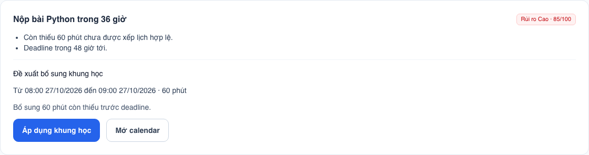

# Task 5 — AI phân bổ thời gian và cảnh báo trễ hạn

Ngày cập nhật: 26/10/2026. Thực hiện trên nhánh `dev`.

## Chức năng bổ sung

- **Rủi ro từng task:** điểm 0–100, mức LOW/MEDIUM/HIGH/CRITICAL và lý do cụ thể. Điểm được tính lại từ dữ liệu hiện tại, không gọi OpenAI khi chỉ xem trang.
- **Cảnh báo đỏ:** task chưa quá hạn nhưng có nguy cơ trễ được đánh dấu ở danh sách công việc, trang phân tích và sự kiện calendar liên quan. Màu luôn đi kèm nhãn và điểm để không phụ thuộc vào nhận biết màu.
- **Gợi ý giờ học cụ thể:** hiển thị ngày, giờ bắt đầu/kết thúc và số phút. Hỗ trợ bổ sung lịch còn thiếu hoặc dời khung tự động chưa khóa khi trùng lịch, nằm sau deadline hay trong ngày quá tải.
- **Áp dụng có chủ đích:** nút POST có CSRF; kiểm tra người sở hữu, chữ ký, hạn 15 phút, thay đổi dữ liệu, deadline và trùng lịch. Khóa hàng user bằng transaction trên PostgreSQL để tuần tự hóa các lần áp dụng. Gợi ý đã áp dụng không dùng lại được.
- **Giữ chỉnh sửa:** không tự dời khung thủ công, đã khóa hoặc đã bắt đầu. Khung được chấp nhận sẽ được khóa để thuật toán không ghi đè.
- **Tóm tắt ngày:** giữ chức năng tổng hợp, danh sách ưu tiên, OpenAI tùy chọn và fallback. Insight rủi ro được lưu thêm kết quả từng task từ quy tắc cục bộ.

Không cần migration hay thư viện runtime mới.

## Công thức điểm

Đây là chỉ số ưu tiên có thể giải thích, **không phải xác suất** hoặc mô hình dự báo đã huấn luyện.

- `R = max(0, thời lượng ước tính − phút WORK đã hoàn thành)`.
- `M = max(0, R − phút đã xếp hợp lệ trước deadline)`.
- Khi `R > 0`, `q = M/R`; `ceil` là làm tròn lên.
- `A` là số phút còn trống trước deadline, có xét mục tiêu ngày. `C` là tổng phút chưa xếp của các task theo thứ tự deadline đến task đang xét.

| Điều kiện | Điểm ứng viên |
|---|---|
| Đã học đủ (`R = 0`) | 0; dừng |
| Đã quá hạn và `R > 0` | 100; dừng |
| Chưa đủ lịch (`M > 0`) | `40 + ceil(19q)` |
| `M > 0` và deadline trong 48 giờ | `70 + ceil(15q)` |
| `M > 0`, biết sức chứa và `C > A` | `85 + ceil(14(C−A)/max(1,C))` |
| Có khung của task trong ngày quá tải | Tối thiểu 70 |
| Đủ lịch, không có điều kiện trên | 0 |

Chọn điểm ứng viên cao nhất. Phân loại: dưới 30 LOW, 30–69 MEDIUM, 70–99 HIGH, 100 CRITICAL. Hiện các công thức sinh điểm MEDIUM trong khoảng 41–59.

Nguồn chính: `ai_service/services/risk.py`. Django và FastAPI dùng chung quy tắc; LLM không được quyết định điểm hoặc tự đổi lịch.

## Gợi ý lịch hoạt động như thế nào

1. Xét tối đa 31 ngày và các khung giờ học trong hồ sơ.
2. Tìm khoảng trống trước deadline, tránh lịch bận/Google và giữ nghỉ 15 phút quanh các khung hiện có.
3. Với khung tự động cần dời, giải phóng tạm thời khung đó trong tính toán, giữ nguyên thời lượng và tìm giờ mới.
4. Với phần lịch thiếu, đề xuất một phiên tối đa 120 phút, không vượt mục tiêu ngày. Nếu chỉ đáp ứng một phần, giao diện ghi rõ.
5. Người dùng chọn áp dụng; server kiểm tra lại. Mọi gợi ý khác trên trang được làm mới sau khi áp dụng vì lịch đã thay đổi.

Trang phân tích hiển thị 20 task có điểm cao nhất; liên kết từ danh sách task mở đúng task được chọn. Giới hạn phân tích hiện tại là 1.000 task chưa hoàn thành theo deadline. Không có khung phù hợp thì giải thích để người dùng chỉnh lịch; không hứa xếp đủ mọi công việc.

## Kịch bản demo

1. Tạo task cần 60 phút, deadline còn 36 giờ, chưa xếp lịch.
2. Mở **Task & Deadline**: nhãn đỏ HIGH xuất hiện trước khi quá hạn.
3. Chọn **Xem gợi ý lịch học** để xem điểm, lý do và ngày/giờ cụ thể.
4. Chọn **Áp dụng khung học**: khung mới được tạo và khóa; task đủ lịch chuyển về LOW.
5. Để demo dời lịch, tạo khung tự động chưa khóa trùng lịch bận; trang AI có **Áp dụng dời lịch**, hiển thị giờ cũ và giờ mới.
6. Mở **Tóm tắt hôm nay** để trình bày liên kết Task → Calendar → Pomodoro → AI.

Lưu đồ dùng cho slide 3–8: [Mermaid](docs/task5/risk-flow.mmd), [SVG](static/diagrams/task5-risk-flow.svg), [PNG](static/diagrams/task5-risk-flow.png).

Ảnh demo cảnh báo và nút áp dụng (dữ liệu tổng hợp trên database kiểm thử riêng):



## Sửa lỗi kiểm thử PostgreSQL

Test tải tài liệu gọi trực tiếp `response.close()`, phát tín hiệu kết thúc request và đóng kết nối trong transaction bao ngoài của `TestCase`. Các test phía sau lỗi dây chuyền `connection already closed`.

Đã sửa thành đọc hết `streaming_content` qua iterator của Django test client, để client đóng tệp và quản lý tín hiệu kết nối đúng cách. Không thay đổi luồng download production.

Kiểm tra lại bằng:

```sh
python manage.py test --verbosity 1
USE_SQLITE=False DATABASE_URL=postgresql://USER@localhost:5432/studyflow_task5 python manage.py test --noinput --verbosity 1
python manage.py test apps.browser_checks --verbosity 1
npm ci && npm run build
python manage.py check
python manage.py makemigrations --check --dry-run
python scripts/validate-deployment.py
git diff --check
```

Lệnh PostgreSQL dùng database kiểm thử `test_studyflow_task5`, không dùng database dữ liệu thật. Thay `USER` bằng role PostgreSQL local của bạn.

Kết quả ngày 26/10/2026:

- PostgreSQL 17: **119/119 test đạt**, gồm kiểm tra hai yêu cầu áp dụng đồng thời chỉ tạo một khung.
- SQLite: **118 test đạt, 1 test concurrency PostgreSQL được bỏ qua** (119 test được phát hiện).
- Chromium: **5/5 test đạt**; đã chạy riêng lại luồng Task 5 sau khi bổ sung ảnh demo. Kiểm tra màu cảnh báo, thêm lịch, dời lịch, khóa khung, không tràn ngang ở 375/1440px và các trang còn lại ở 375/800/1920px.
- Django check, migration check, build frontend, collectstatic, diff check: đạt. Không có migration mới.
- Render Blueprint: schema PASS; **không đồng nghĩa đã deploy**.
- CI mở rộng thành hai nhánh SQLite/PostgreSQL. Chưa có run GitHub cho bản sửa này vì thay đổi chưa commit/push.

Kiểm thử HTTP/API bổ sung ở `apps/test_task5.py`; bài test trình duyệt ở `apps/browser_checks.py`. Ảnh đầy đủ được lưu trong `test-results/task5/` và được Git bỏ qua; ảnh demo chọn lọc nằm trong `docs/task5/`.

Giao diện tái sử dụng `sf-card`, `sf-button`, `sf-secondary` và kiểu badge mức ưu tiên đã có ở trang task. Bỏ toàn bộ CSS riêng `sf-risk-*`, `sf-task-risk-*`, `sf-proposal`, viền đỏ dày và panel xanh được thêm ban đầu; khung đề xuất dùng đường phân cách `border-slate-100` giống các khối hiện có. Font, màu brand/slate, độ bo góc và bố cục full-width giữ theo web cũ. Skill UI/UX Pro Max chỉ được dùng để rà soát nhãn chữ và phản hồi thao tác, không tạo hệ giao diện mới.

## Triển khai online — phần cần tài khoản hosting

Blueprint Render hiện tại đã có web, FastAPI riêng, PostgreSQL, Redis, worker, beat và media disk. Script kiểm tra schema chính thức đã PASS trong đợt này. Máy chưa có phiên/token Render, Railway hay Fly; chưa có URL production của dự án được cung cấp.

Chưa tạo tài nguyên trả phí và chưa có bằng chứng deploy online. Để hoàn tất yêu cầu URL của đề, chủ tài khoản cần kết nối repo/nhánh `dev` qua Blueprint Render, kiểm tra chi phí, cấu hình biến môi trường và cung cấp URL để nghiệm thu. Xem hướng dẫn Deploy Render trong README.
